<picture>
  <source media="(prefers-color-scheme: dark)" srcset="assets/banner-dark.svg">
  <source media="(prefers-color-scheme: light)" srcset="assets/banner-light.svg">
  
</picture>

  
  
  
  
  
  
  
  
  
  

### About

I build tools that trade, watch markets and remove repetitive work: bots for prediction markets and crypto, token scanners, a payments-ready API and browser automation. The projects below have test suites that run in CI, and the trading code is built paper-first with explicit safety gates.

### Featured projects

<table>
  <tr>
    <td width="50%" valign="top">
      <h4><a href="https://github.com/lowriskbtc/polymarket-bot">polymarket-bot</a></h4>
      Bot for Polymarket's 5 and 15 minute crypto markets: rule-based strategies, a pure-Python ML model and reinforcement-learning gates behind a Flask dashboard.  
      
    </td>
    <td width="50%" valign="top">
      <h4><a href="https://github.com/lowriskbtc/ai-decision-engine-api">ai-decision-engine-api</a></h4>
      FastAPI service for risk-scored decisions with hashed API keys, Stripe billing, and JSON or SQLite storage, tested on both backends.  
      
    </td>
  </tr>
  <tr>
    <td width="50%" valign="top">
      <h4><a href="https://github.com/lowriskbtc/solseller">solseller</a></h4>
      Solana trading terminal over Jupiter with a server-side take-profit / stop-loss executor and exact bonding-curve math.  
      
    </td>
    <td width="50%" valign="top">
      <h4><a href="https://github.com/lowriskbtc/hyperliquid-pro">hyperliquid-pro</a></h4>
      Self-hosted Hyperliquid terminal with a paper-first scalping stack and optional local-LLM trade judging.  
      
    </td>
  </tr>
  <tr>
    <td width="50%" valign="top">
      <h4><a href="https://github.com/lowriskbtc/solana-scanner">solana-scanner</a></h4>
      Memecoin scanner that scores new tokens and rotates across free LLM providers, failing over cleanly when one goes down.  
      
    </td>
    <td width="50%" valign="top">
      <h4><a href="https://github.com/lowriskbtc/docx-desk">docx-desk</a></h4>
      Word document editor that runs entirely in the browser and keeps the original formatting. Nothing is uploaded.  
      
    </td>
  </tr>
  <tr>
    <td width="50%" valign="top">
      <h4><a href="https://github.com/lowriskbtc/antirugdex">antirugdex</a></h4>
      Verifiable token launches on Solana: a Token-2022 fee token, an Anchor fair-sale program that seeds a Raydium pool and burns the LP, and an on-chain rug-risk grader. Verified end to end on devnet.  
      
    </td>
    <td width="50%" valign="top">
      <h4><a href="https://github.com/lowriskbtc/duck-store">duck-store</a></h4>
      Flask storefront with Stripe checkout, server-side pricing, buyer-only downloads and a password-protected admin, deployed on Vercel with Postgres.  
      
      
    </td>
  </tr>
</table>

### How the code is checked

- **450+ automated tests** across nine repositories, running on every push with GitHub Actions.
- **Mutation-tested:** each protection was broken on purpose to confirm a test catches it.
- **Safe by default:** secrets stay out of code, trading defaults to paper mode, and anything ambiguous fails safe.

  

